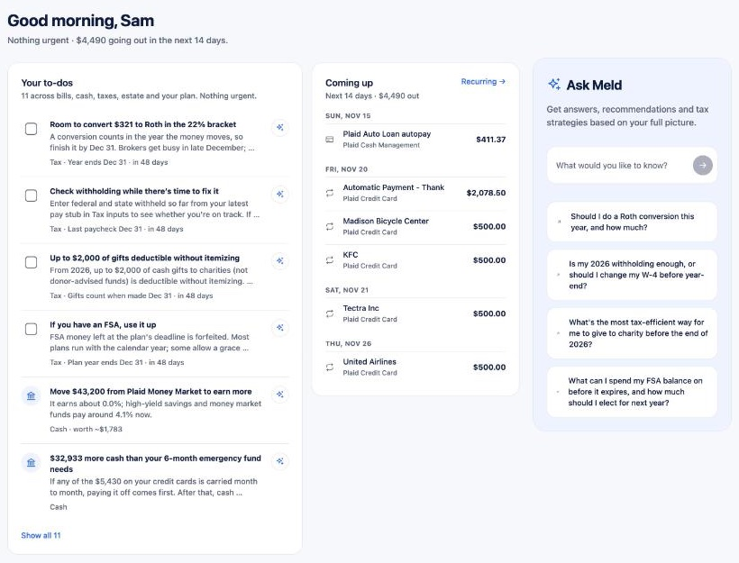
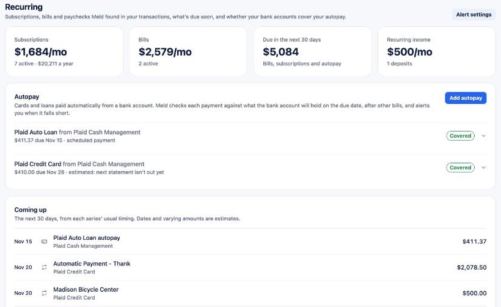
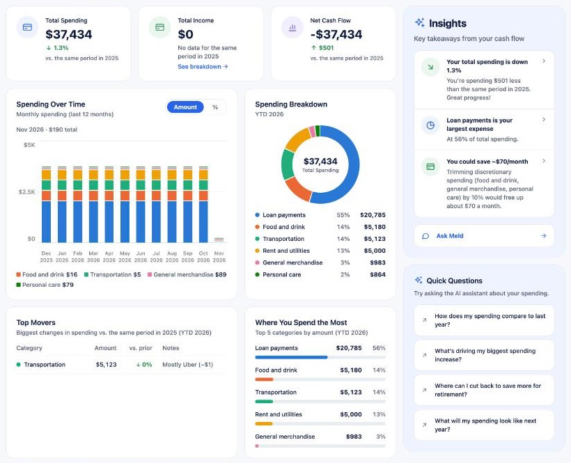
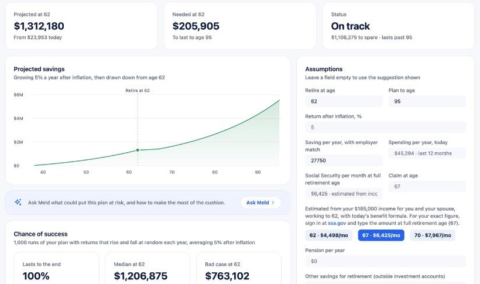
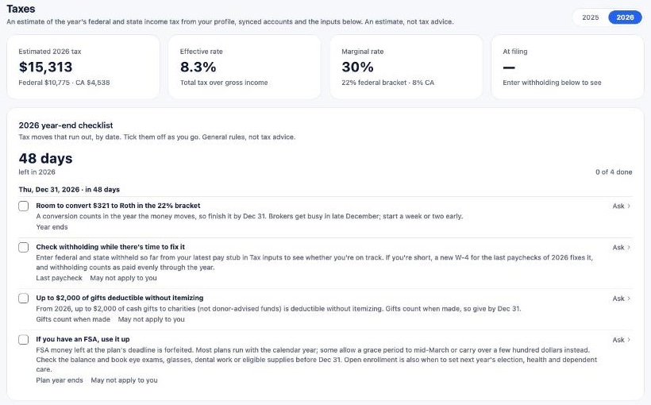

#  Meld

**Your whole financial picture. No subscription, no cloud.**

Meld brings your bank accounts, cards, investments, loans and insurance into one place, tells you what needs doing, and answers questions about your money with AI. It runs on your own computer: there's no Meld server and no account to create, and your data stays in a database on your machine.

[Download for Mac](https://github.com/shimizust/meld-finance/releases/latest) · [Website](https://shimizust.github.io/meld-finance/) · [Features](docs/features.md) · [Privacy](PRIVACY.md) · [Security](SECURITY.md)



<sub>Screenshots use Plaid's sandbox test bank, not real data.</sub>

## Why Meld

Meld started because no single app answered everyday money questions and long-term ones from the same, complete set of accounts:

- **Retirement planners** (ProjectionLab, Boldin) do the long view well, but balances are typed in by hand, or synced only on a paid plan or through another app, and they don't tell you what you spent last month or which bills went up.
- **Budgeting apps** (Monarch, YNAB, Copilot) track spending for a yearly fee, and leave retirement, taxes, insurance and estate planning to a spreadsheet.
- **AI assistants** (ChatGPT and Claude) can now link bank accounts, but that's one more place to connect everything, and they see only what you link, not your home, policies, tax estimate or retirement plan.
- **Self-hosted apps** (Actual, Firefly III) are free and keep your data yours, but they're mostly about budgeting, and bank syncing usually means running a server with Docker and paying for SimpleFIN.

With Meld you link your accounts once. The same data answers this week's questions (what's recurring, where the money went, will autopay clear) and the big ones (am I on track, what will I owe), and Ask Meld sees all of it when you ask for tax or money advice.

## What it does

- **Know a payment will clear before it's due.** Meld finds your subscriptions, bills and paychecks, checks that each autopay's bank account will hold enough on the day, and alerts you (on your phone too, with ntfy) when one won't.
- **See where your money went, and what changed.** Spending against the same period last year, drill-downs by category and merchant, your own category rules and budgets. Card payments and transfers aren't counted twice.
- **Everything you own and owe on one screen.** Banks, cards, brokerages, loans and mortgages through Plaid, plus your home, car and life insurance cash value, with daily net worth.
- **A straight answer on retirement.** A projection in today's dollars with Social Security, property, what-if scenarios and 1,000 simulated markets.
- **No surprises in April.** This year's federal and California tax estimate from your real income and trades, and a year-end checklist of moves with deadlines.
- **Investments, cash, insurance and estate.** Time-weighted returns and look-through allocation, emergency fund runway, coverage read from your policy PDFs, and a family packet that lists every account and who to call.
- **Ask Meld.** Ask about your own numbers with Claude, or a local model through Ollama. It can read your data but never change it.

<table>
  <tr>
    <td width="50%"></td>
    <td width="50%"></td>
  </tr>
  <tr>
    <td></td>
    <td></td>
  </tr>
</table>

More in [docs/features.md](docs/features.md).

## How it compares

| | Price | What it covers | Bank syncing | Where your data lives | Setup |
| --- | --- | --- | --- | --- | --- |
| **Meld** | **Free** | Spending, bills, investments, retirement, tax, insurance, estate, and AI over all of it | Your own Plaid keys (free for up to 10 bank logins) | **Your Mac or your server** | 🟡 Some setup: a Mac app plus a free Plaid developer account (Plaid approves it before real banks connect). Docker is optional |
| ***Budgeting apps*** | | | | | |
| Monarch | $99.99/yr ($199.99 Plus) | Spending, budgets, net worth | Built in | Their servers | 🟢 Easy |
| YNAB | $109/yr | Budgeting | Built in | Their servers | 🟢 Easy |
| Copilot | $109/yr | Spending, budgets, investments | Built in | Their servers | 🟢 Easy |
| Simplifi | $47.88 first year, then $83.88/yr | Spending, budgets, bills | Built in | Their servers | 🟢 Easy |
| ***Retirement planners*** | | | | | |
| ProjectionLab | Free; Premium $129/yr | Retirement and long-term plans | None: type balances in, or pull them from Monarch, YNAB or Lunch Money with a plugin | Their servers | 🟢 Easy, but keeping balances current is on you |
| Boldin | Free; PlannerPlus $168/yr | Retirement plans | PlannerPlus only | Their servers | 🟢 Easy |
| ***AI assistants*** | | | | | |
| ChatGPT Finances | Free on every US plan; Plus $20/mo | Questions about the accounts you link | Built in | OpenAI's servers | 🟢 Easy |
| Claude Personal Finance (beta) | Pro $20/mo ($17/mo billed yearly), Max $100/mo or Ultra $200/mo | Questions about the accounts you link | Built in | Anthropic's servers | 🟢 Easy |
| ***Self-hosted, open source*** | | | | | |
| Actual Budget | Free; SimpleFIN $15/yr for US bank sync | Envelope budgeting | Through SimpleFIN, and only with a server | Your computer or your server | 🟢 Easy on one computer; 🔴 Technical for bank sync and phone access (Docker server, or paid PikaPods hosting) |
| Firefly III | Free; SimpleFIN $15/yr for US bank sync | Transactions, budgets, reports | Through a separate Data Importer and SimpleFIN | Your server | 🔴 Technical: Docker Compose with a database, plus a second container for imports |

🟢 Easy: sign up and go. 🟡 Some setup: an app to install and accounts to make, no command line. 🔴 Technical: run a server with Docker, a database and a web address.

<sub>US list prices for annual plans as of November 2026. Meld isn't affiliated with these companies or projects.</sub>

The trade-off is setup: you bring your own free Plaid developer account, and Plaid approves it before real banks connect. That's also the point: no company sits between you and your bank, and there's no account database to leak.

> **Not financial advice.** Meld's estimates and suggestions (tax, retirement, estate, Ask Meld) are for planning and education, not professional financial, tax or legal advice. Check anything important with a professional.

## What you need

- **Your own [Plaid](https://dashboard.plaid.com/signup) developer account.** Meld has no server of its own, so it connects to your banks with your Plaid keys. Sandbox (fake data) is free and instant. Real accounts need Plaid to approve production access; the free Trial plan covers up to 10 bank logins. [docs/plaid.md](docs/plaid.md) walks through it.
- **Optional:** an [Anthropic API key](https://console.anthropic.com/) for Ask Meld with Claude, PDF extraction and value lookups (you pay Anthropic for usage), or [Ollama](https://ollama.com) for a local chat model.

## Install on a Mac

1. [Download the latest release](https://github.com/shimizust/meld-finance/releases/latest): `Meld-<version>-arm64.dmg` for Apple silicon or `-x64.dmg` for Intel, and drag Meld to Applications.
2. Builds aren't notarized by Apple yet, so the first time you open Meld macOS will refuse. Go to **System Settings → Privacy & Security**, scroll down and click **Open Anyway** (or run `xattr -dr com.apple.quarantine /Applications/Meld.app`).
3. Meld walks you through setup the first time it opens: a passphrase (optional), your Plaid client ID and secrets (with a **Test keys** button), and optionally an Anthropic key or Ollama, which it finds by itself if it's running.
4. Start with Plaid's Sandbox to look around (any bank, `user_good` / `pass_good`), then follow [docs/plaid.md](docs/plaid.md) to connect your real accounts and switch to production in **Settings**.

Everything stays on your Mac in `~/Library/Application Support/Meld`: a Postgres database that only listens on `127.0.0.1`, uploaded documents, settings, and logs. The keys that encrypt Plaid tokens, documents and saved settings are made on first run and kept encrypted with your macOS Keychain. Closing the window leaves Meld running in the menu bar, where you can also turn on **Open at Login**, show the data folder or quit.

- **Change settings:** account menu → **Settings** (Plaid keys and environment, AI, passphrase on or off, phone access). Saving restarts Meld in a few seconds.
- **Back up:** quit Meld, then copy `~/Library/Application Support/Meld`. The copy is only readable with this Mac's Keychain, so also keep a Time Machine backup (which includes the Keychain), or you'd have to re-link accounts after restoring elsewhere.

## Use Meld on your phone

Meld never opens itself to the internet. Your phone reaches it over [Tailscale](https://tailscale.com), a free private network that only your devices are on:

1. Install Tailscale on your Mac and your phone and sign in to both with the same account.
2. Turn on HTTPS certificates for your tailnet (one switch in the Tailscale admin console, under **DNS**).
3. In Meld, open **Settings → Phone access** (or **Phone Access…** in the menu bar) and click **Turn on phone access**. Scan the QR code with your phone, unlock with your passphrase, and use **Add to Home Screen** so it opens like an app.

Your phone can reach Meld while your Mac is awake and Meld is running. For an always-on setup, run it on a home server with Docker instead.

## Always-on or self-hosted (Docker)

Docker runs Meld on any machine that's always on (a home server, a NAS, a Linux box): one container for Postgres and one for Meld, which serves the web app and the API.

```sh
git clone https://github.com/shimizust/meld-finance.git && cd meld-finance
./scripts/setup.sh            # creates .env with fresh secrets (and, if you like, your passphrase)
docker compose up -d --build
```

Open http://localhost:8080. Anything not in `.env` (passphrase, Plaid keys, AI) is asked for the first time Meld opens and saved in the `meld-config` volume; values in `.env` always win.

- **Update:** `git pull && docker compose up -d --build --remove-orphans`. Database migrations run automatically.
- **Stop:** `docker compose down`. Your data stays in Docker volumes (`meld-db`, `meld-documents`, `meld-config`); `docker compose down -v` deletes it.
- **Back up:** `docker compose exec db pg_dump -U meld meld > meld-backup.sql`, and keep `.env` somewhere safe too: without its `ENCRYPTION_KEY` you'd have to re-link your accounts.
- **Change settings:** in the app (**Settings**) for anything not set in `.env`; otherwise edit `.env`, then `docker compose up -d`.
- **From your phone:** Meld only listens on `localhost`, and its login is a single passphrase, so don't open it to the internet. Put the server and your phone on [Tailscale](https://tailscale.com) and run `tailscale serve --bg 8080` on the server, which adds HTTPS and keeps it off the public internet.

## Development

Meld is a TypeScript monorepo: a Fastify API with Postgres, an Expo app (web now, iOS and Android later) and an Electron shell for macOS. [docs/development.md](docs/development.md) covers running it from source, building the Mac app and releases. Issues and pull requests are welcome; see [CONTRIBUTING.md](CONTRIBUTING.md).

## Security

Meld is built for one household on hardware you control: it listens on localhost only, encrypts Plaid tokens, documents and keys at rest, and reaches your phone over Tailscale rather than the internet. Don't expose it to the public internet. Details and how to report a vulnerability privately are in [SECURITY.md](SECURITY.md).

## License

[GNU AGPL v3](LICENSE). You can use, change and share Meld freely. If you run a modified version as a service for other people, you must share your changes under the same license.
