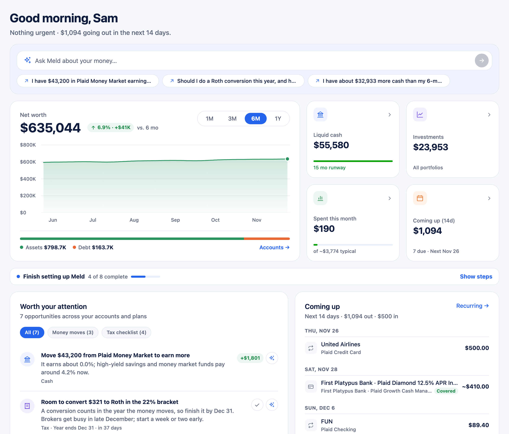
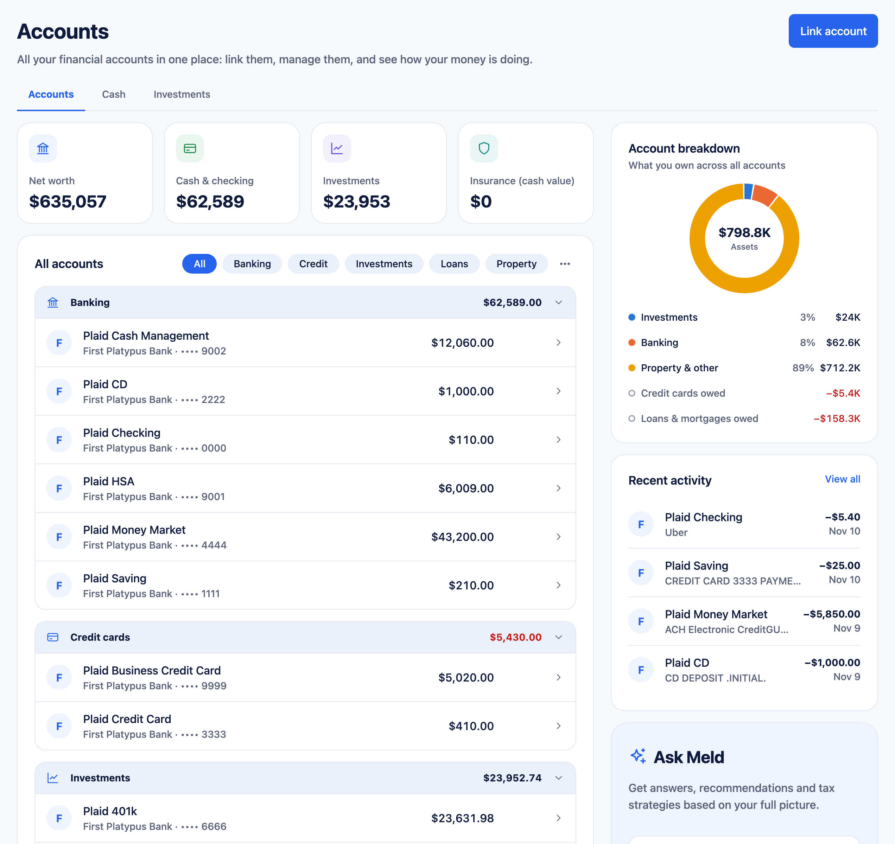
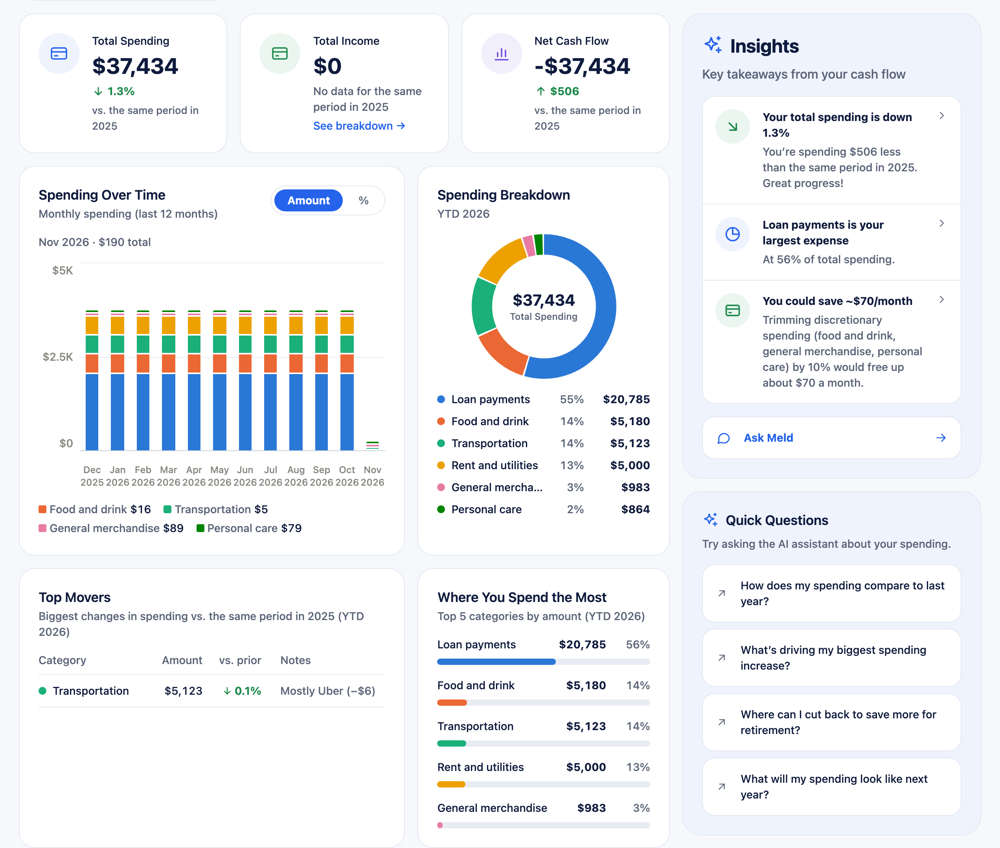
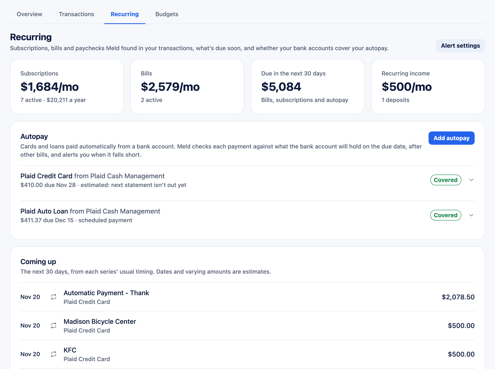
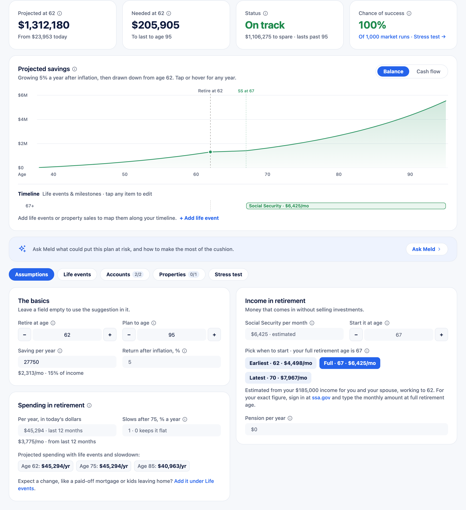

#  Meld

**Your whole financial picture. No subscription, no cloud.**

Meld brings your bank accounts, cards, investments, loans and insurance into one place, tells you what needs doing, and answers questions about your money with AI. It runs on your own computer: there's no Meld server and no account to create, and your data stays in a database on your machine.

Download for Mac: [Apple silicon](https://github.com/meld-finance/meld/releases/latest/download/Meld-arm64.dmg) or [Intel](https://github.com/meld-finance/meld/releases/latest/download/Meld-x64.dmg) · [Windows (preview)](https://github.com/meld-finance/meld/releases/latest/download/Meld-x64-setup.exe) · [Website](https://meld-finance.github.io/meld/) · [Docs](https://meld-finance.github.io/meld/docs/) · [Install](docs/install.md) · [Features](docs/features.md) · [Phone access](docs/phone-access.md) · [Docker](docs/docker.md) · [Privacy](PRIVACY.md) · [Security](SECURITY.md)

Screenshots use Plaid's sandbox test bank, not real data.

## Why Meld

Meld started because no single app answered everyday money questions and long-term ones from the same, complete set of accounts—with automatic bank syncing instead of time-consuming, one-time CSV imports:

- **Retirement planners** (ProjectionLab, Boldin) do the long view well, but balances are typed in by hand, imported via one-time CSVs, or synced only on a paid plan or through another app, and they don't tell you what you spent last month or which bills went up.
- **Budgeting apps** (Monarch, YNAB, Copilot) track spending for a yearly fee, and leave retirement, taxes, insurance and estate planning to a spreadsheet.
- **AI assistants** (ChatGPT and Claude) can now link bank accounts, but that's one more place to connect everything, and they see only what you link, not your home, policies, tax estimate or retirement plan.
- **Self-hosted apps** (Actual, Firefly III) are free and keep your data yours, but they're mostly about budgeting, and bank syncing usually means running a server with Docker, paying for SimpleFIN, or doing manual CSV imports.

With Meld you link your accounts once and they sync automatically every few hours—no tedious CSV imports. The same live data answers this week's questions (where the money went, what's recurring, will autopay clear) and the big ones (am I on track, what will I owe, is my estate in order), and Ask Meld sees all of it when you ask for tax or money advice.

## What it does

- **Accounts & net worth.** Banks, cards, brokerages, 401(k)s, loans and mortgages through Plaid, plus your home, car and life insurance cash value, with daily net worth.
- **Spending.** Where it went and what changed against the same period last year, drill-downs by category and merchant, custom category rules and monthly budgets. Card payments and transfers aren't counted twice.
- **Bills & autopay.** Meld finds your subscriptions, bills and paychecks, checks that each autopay's bank account will hold enough on the due date, and alerts you (on your phone too, with ntfy) when one won't.
- **Cash & emergency fund.** Liquid cash across checking, savings, money market funds and T-bills, estimated APY, months of runway from your real spending, and idle-cash nudges.
- **Investments across all your accounts.** See your overall asset allocation across multiple brokerage and retirement accounts combined, look-through sector/region/bond exposure inside funds, time-weighted returns and dividend income.
- **Retirement.** A projection in today's dollars with Social Security, property sales, life events, what-if scenarios and 1,000 simulated markets.
- **Estate & family packet.** Flags missing beneficiaries and documents, keeps trusts/wills/POAs and contacts organized, and exports a PDF family packet (optionally password-protected) listing every account and who to call.
- **Tax & insurance.** Federal and California tax estimates with a year-end checklist, plus life and disability policy coverage read from PDFs and checked against your family's needs.
- **Ask Meld.** Ask about your own numbers using free local models through Ollama, your ChatGPT Go, Plus, Pro or Business plan (no API key needed), Gemini and other models through OpenRouter, or Claude.

<table>
  <tr>
    <td width="50%"></td>
    <td width="50%"></td>
  </tr>
  <tr>
    <td></td>
    <td></td>
  </tr>
</table>

More in [docs/features.md](docs/features.md).

## How it compares

| | Price | What it covers | Bank syncing | Where your data lives | Setup |
| --- | --- | --- | --- | --- | --- |
| **Meld** | **Free** | Spending, bills, investments, retirement, tax, insurance, estate, and AI over all of it | Your own Plaid keys (free for up to 10 bank logins; any number of accounts per login) | **Your computer or your server** | 🟡 Some setup: a Mac or Windows app plus a free Plaid developer account (usually approved automatically). Docker is optional |
| ***Budgeting apps*** | | | | | |
| Monarch | $99.99/yr ($199.99 Plus) | Spending, budgets, net worth | Built in | Their servers | 🟢 Easy |
| YNAB | $109/yr | Budgeting | Built in | Their servers | 🟢 Easy |
| Copilot | $109/yr | Spending, budgets, investments | Built in | Their servers | 🟢 Easy |
| Simplifi | $47.88 first year, then $83.88/yr | Spending, budgets, bills | Built in | Their servers | 🟢 Easy |
| ***Retirement planners*** | | | | | |
| ProjectionLab | Free; Premium $129/yr | Retirement and long-term plans | None: type balances in, or pull them from Monarch, YNAB or Lunch Money with a plugin | Their servers | 🟢 Easy, but keeping balances current is on you |
| Boldin | Free; PlannerPlus $168/yr | Retirement plans | PlannerPlus only | Their servers | 🟢 Easy |
| ***AI assistants*** | | | | | |
| ChatGPT Finances | Free on every US plan; Plus $20/mo | Questions about the accounts you link | Built in | OpenAI's servers | 🟢 Easy |
| Claude Personal Finance (beta) | Pro $20/mo ($17/mo billed yearly), Max $100/mo or Ultra $200/mo | Questions about the accounts you link | Built in | Anthropic's servers | 🟢 Easy |
| ***Self-hosted, open source*** | | | | | |
| Actual Budget | Free; SimpleFIN $15/yr for US bank sync | Envelope budgeting | Through SimpleFIN, and only with a server | Your computer or your server | 🟢 Easy on one computer; 🔴 Technical for bank sync and phone access (Docker server, or paid PikaPods hosting) |
| Firefly III | Free; SimpleFIN $15/yr for US bank sync | Transactions, budgets, reports | Through a separate Data Importer and SimpleFIN | Your server | 🔴 Technical: Docker Compose with a database, plus a second container for imports |

🟢 Easy: sign up and go. 🟡 Some setup: an app to install and accounts to make, no command line. 🔴 Technical: run a server with Docker, a database and a web address.

US list prices for annual plans as of November 2026 (Monarch Plus is $199.99/yr). ChatGPT and Claude are monthly: ChatGPT Finances works on every US plan, including Free; Claude Personal Finance needs Pro ($17/mo billed yearly), Max ($100/mo) or Ultra ($200/mo). Meld isn't affiliated with these companies or projects.

The trade-off is setup: you create your own free Plaid account, about 10 minutes with [step-by-step pictures](docs/plaid.md) (Plaid should approve it automatically for personal use). You can look around with demo data first. That's also why it's worth it: your data sits in a database on your own computer with no central service storing it, and you use your own Plaid keys to connect directly to your banks.

> **Not financial advice.** Meld's estimates and suggestions (tax, retirement, estate, Ask Meld) are for planning and education, not professional financial, tax or legal advice. Check anything important with a professional.

## What you need

- **Your own free [Plaid](https://dashboard.plaid.com/signup) account, when you're ready for real data.** Meld has no server of its own, so it connects directly to your banks with your Plaid keys. Sign-up takes about 10 minutes and Plaid usually approves it automatically; the free Trial plan covers up to 10 bank logins, and each login can include any number of accounts at that bank. [docs/plaid.md](docs/plaid.md) shows every screen. Until then, Meld's demo data needs nothing.
- **Optional AI:** [Ollama](https://ollama.com) for completely free local chat models, a ChatGPT Go, Plus, Pro or Business plan (sign in under **Settings → AI → ChatGPT plan**), an [OpenRouter API key](https://openrouter.ai/settings/keys) for Gemini, GPT, Claude and more (Ask Meld, PDF extraction and value lookups), or an [Anthropic API key](https://console.anthropic.com/) for Ask Meld with Claude, PDF extraction and value lookups.

## Install on a Mac

1. Download Meld for [Apple silicon](https://github.com/meld-finance/meld/releases/latest/download/Meld-arm64.dmg) or [Intel](https://github.com/meld-finance/meld/releases/latest/download/Meld-x64.dmg) (not sure? Apple menu → **About This Mac**: "Apple M…" is Apple silicon), open it and drag Meld to Applications.
2. Open Meld. The first time, macOS asks whether you're sure you want to open an app downloaded from the Internet: click **Open**. Every app downloaded outside the App Store gets this once. Meld is signed and notarized by Apple, so you won't see the "cannot be opened" warning unsigned apps get.
3. Meld opens on a welcome screen that shows where your data goes. Choose **Start with tour** or **Explore on my own** to look around a made-up household, or **Connect my banks** for the guided Plaid sign-up ([docs/plaid.md](docs/plaid.md) has the same steps with pictures). You can also switch into demo mode anytime from the account menu or Settings.
4. That's all the setup. Meld's own window never asks for a passphrase; you choose one only to open Meld in a browser or on your phone. AI is optional and set up from Ask Meld when you want it.

Everything stays on your Mac in `~/Library/Application Support/Meld`: a Postgres database that only listens on `127.0.0.1`, uploaded documents, settings, and logs. The keys that encrypt Plaid tokens, documents and saved settings are made on first run and kept encrypted with your macOS Keychain. Closing the window leaves Meld running in the menu bar, where you can also turn on **Open at Login**, show the data folder or quit.

- **Change settings:** account menu → **Settings** (bank connections, AI, a passphrase for browsers and phones, phone access). Saving restarts Meld in a few seconds.
- **Back up:** quit Meld, then copy `~/Library/Application Support/Meld`. The copy is only readable with this Mac's Keychain, so also keep a Time Machine backup (which includes the Keychain), or you'd have to re-link accounts after restoring elsewhere.

## Install on Windows (preview)

Windows 10 and 11, 64-bit Intel/AMD. The Windows app is new and hasn't had much testing yet, so expect rough edges and please [open an issue](https://github.com/meld-finance/meld/issues) if something breaks.

1. [Download the installer](https://github.com/meld-finance/meld/releases/latest/download/Meld-x64-setup.exe) and run it. It installs for your user only, with no admin prompt.
2. The installer isn't code-signed yet, so Windows SmartScreen says it "protected your PC" the first time. Click **More info**, then **Run anyway**.
3. Setup is the same as on a Mac: demo data or your Plaid keys.

Everything stays in `%APPDATA%\Meld`, and the encryption keys are kept in Windows Credential Manager (item `Meld`). Closing the window leaves Meld running in the notification area by the clock: click its icon to open Meld, or right-click for **Open at Login**, the data folder, the log and **Quit**. Updates work as on the Mac. To back up, quit Meld and copy `%APPDATA%\Meld`; restoring it on another PC means re-linking your banks, since the keys stay in this PC's Credential Manager.

## Use Meld on your phone

Meld never opens itself to the internet. Your phone reaches it over [Tailscale](https://tailscale.com), a free private network that only your devices are on:

1. Install Tailscale on **both your computer and your phone** and sign in to both with the same account.
2. Turn on HTTPS certificates for your tailnet (one switch in the Tailscale admin console, under **DNS**).
3. In Meld, open **Settings → Phone access** (or **Phone Access…** in the menu bar), choose a passphrase for your phone if you haven't yet, and click **Turn on phone access**. Scan the QR code with your phone, unlock with the passphrase, and use **Add to Home Screen** so it opens like an app.

Full instructions and troubleshooting live in [docs/phone-access.md](docs/phone-access.md).

## Keep it running

Your phone can reach Meld whenever your computer is awake and Meld is running, and that's also when it syncs your accounts and sends alerts. For an always-on setup you don't need a server: run the app on a computer that stays on (a Mac mini or desktop PC), turn on **Open at Login**, and stop the computer from sleeping. [docs/install.md](docs/install.md#keep-it-running) has the exact settings.

Docker is for machines the app doesn't run on (Linux, a NAS) or for when Meld has to start after a reboot without anyone logging in. See [docs/docker.md](docs/docker.md).

## Development

Meld is a TypeScript monorepo: a Fastify API with Postgres, an Expo app (web now, iOS and Android later) and an Electron shell for macOS and Windows. [docs/development.md](docs/development.md) covers running it from source, building the Mac and Windows apps and releases. Issues and pull requests are welcome; see [CONTRIBUTING.md](CONTRIBUTING.md).

## Security

Meld is built for one household on hardware you control: it listens on localhost only, encrypts Plaid tokens, documents and keys at rest, and reaches your phone over Tailscale rather than the internet. Don't expose it to the public internet. Details and how to report a vulnerability privately are in [SECURITY.md](SECURITY.md).

## License

[GNU AGPL v3](LICENSE). You can use, change and share Meld freely. If you run a modified version as a service for other people, you must share your changes under the same license.
