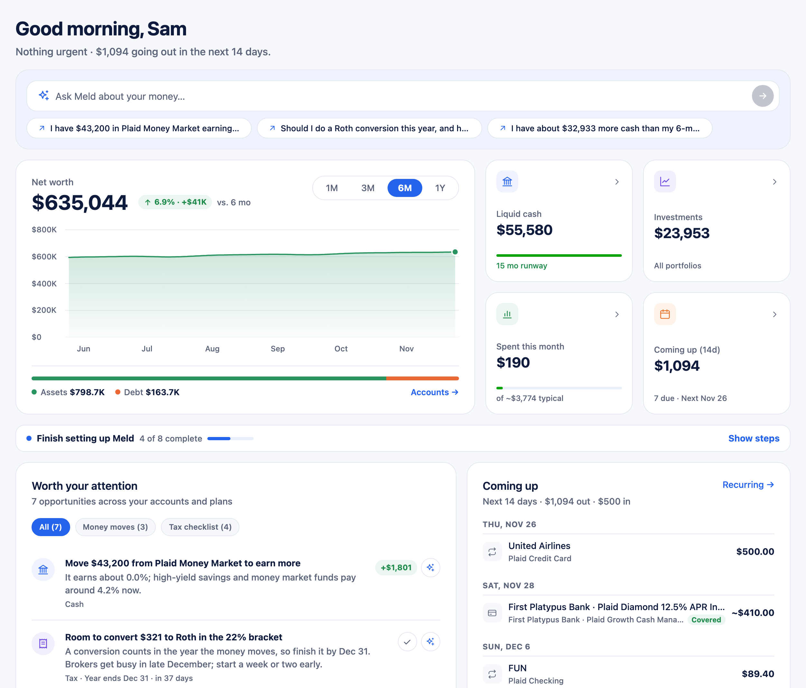

[Meld home page](https://meld-finance.github.io/meld/) · [Docs](https://meld-finance.github.io/meld/docs/) · [README](../README.md) · [Plaid setup](plaid.md) · [Phone access](phone-access.md) · [Docker setup](docker.md)

# Features & Guide

What each part of Meld does and how it works. For installing, see [Install](install.md). Each area below has its own guide with screenshots.

> **Built for the US.** Meld is built for US households—US banks through Plaid, US dollars, 401(k)/IRA/HSA accounts, Social Security, and US federal & state taxes—and won't work well outside the US.
>
> **Not financial advice.** Meld's estimates and suggestions (tax, retirement, estate, Ask Meld) are simple planning and educational tools, not professional financial, tax or legal advice.

## The app at a glance

Five tabs:

- **Home** — net worth, tasks that need attention, and what's coming up
- **Ask Meld** — AI chat about your money and how Meld works
- **Accounts** — linked banks, Cash, and Investments
- **Spending** — Overview, Transactions, Recurring, Budgets
- **Plan** — Retirement, Tax, Insurance, Estate, Profile

## Guides

| Guide | What it's for |
| --- | --- |
| [Demo data & tour](features/demo.md) | Look around with the Rivera household and the product tour |
| [Linking accounts](features/accounts.md) | Connect banks with Plaid, sync, reconnect, Sandbox |
| [Home, spending & budgets](features/home-and-spending.md) | Net worth, cash flow, categories, rules, budgets |
| [Recurring, autopay & alerts](features/recurring-and-alerts.md) | Subscriptions, bills, autopay coverage, ntfy push |
| [Cash & emergency fund](features/cash.md) | Liquid cash, APYs, runway, idle-cash nudges |
| [Investments & loans](features/investments.md) | Holdings, performance, exposure, RSU equity, loan payoff |
| [Retirement](features/retirement.md) | Today's-dollar projections, Social Security, gap |
| [Tax](features/tax.md) | Simple US federal & state estimates (all 50 states + DC), common checks, deadlines |
| [Insurance](features/insurance.md) | Life and disability policies, PDF upload |
| [Estate](features/estate.md) | Beneficiaries, documents, family packet |
| [Ask Meld](features/ask-meld.md) | Claude, ChatGPT, Gemini, OpenRouter, or Ollama |
| [External agents (MCP)](features/mcp.md) | Read-only MCP for Claude Code, Cursor, and others |

Setup that isn't a product screen: [Phone access over Tailscale](phone-access.md) · [Docker self-hosting](docker.md) · [Privacy](../PRIVACY.md) · [Security](../SECURITY.md)
