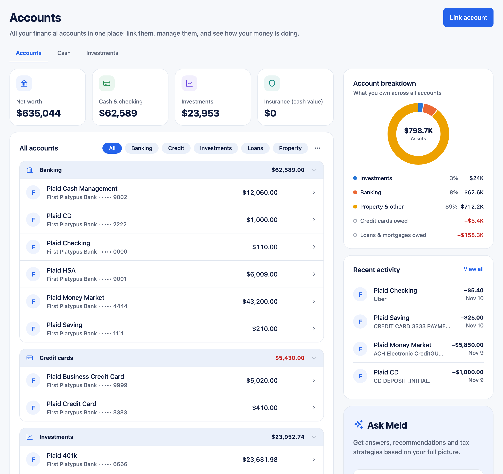

[Meld home page](https://meld-finance.github.io/meld/) · [Docs](https://meld-finance.github.io/meld/docs/) · [Features](../features.md) · [Plaid setup](../plaid.md)

# Linking accounts

Meld pulls balances, transactions, investments and loans through [Plaid](https://plaid.com) with **your own** free developer keys. Step-by-step screenshots of Plaid's sign-up live in [Connecting your accounts with Plaid](../plaid.md).

## Where to find it

- **Accounts → Link account** in the web app
- Keys: first-run setup, **Connect your banks**, or **Settings → Bank connections**
- Sandbox: **Settings → Bank connections → Developer options**

## Syncing

Use **Accounts → Link account**. Accounts and balances sync immediately; transaction history (up to 2 years) arrives over the next minute or so and is fetched automatically. Every linked connection also re-syncs every 6 hours while the API is running, or on demand with **Refresh**.

## Keys and environments

- **Production keys:** your own Plaid client ID and production secret (`PLAID_CLIENT_ID`, `PLAID_PRODUCTION_SECRET`, `PLAID_ENV=production` in `.env`). The guided sign-up shows each Plaid screen; [Connecting your accounts with Plaid](../plaid.md) has the same steps. The free Trial plan covers up to 10 bank logins, and each login can include any number of accounts at that bank.
- **Sandbox** (for developers): paste the Sandbox secret and switch environments (`PLAID_SANDBOX_SECRET`, `PLAID_ENV=sandbox`). Pick any institution and sign in with `user_good` / `pass_good`.
- Each environment, and demo data, has its own database (`SANDBOX_DATABASE_URL`, `PRODUCTION_DATABASE_URL`, `DEMO_DATABASE_URL`), so they never mix. Switching restarts the API.

## Reconnect and mobile

If a bank needs you to sign in again, the connection shows **Reconnect**, which reopens Plaid Link in update mode.

Linking on iOS/Android arrives with the mobile phase; use the web app until then.

## Related

- [Demo data & tour](demo.md) — explore without keys first
- [Home, spending & budgets](home-and-spending.md) — what linked data feeds
- [Investments & loans](investments.md) — holdings and liabilities sync
