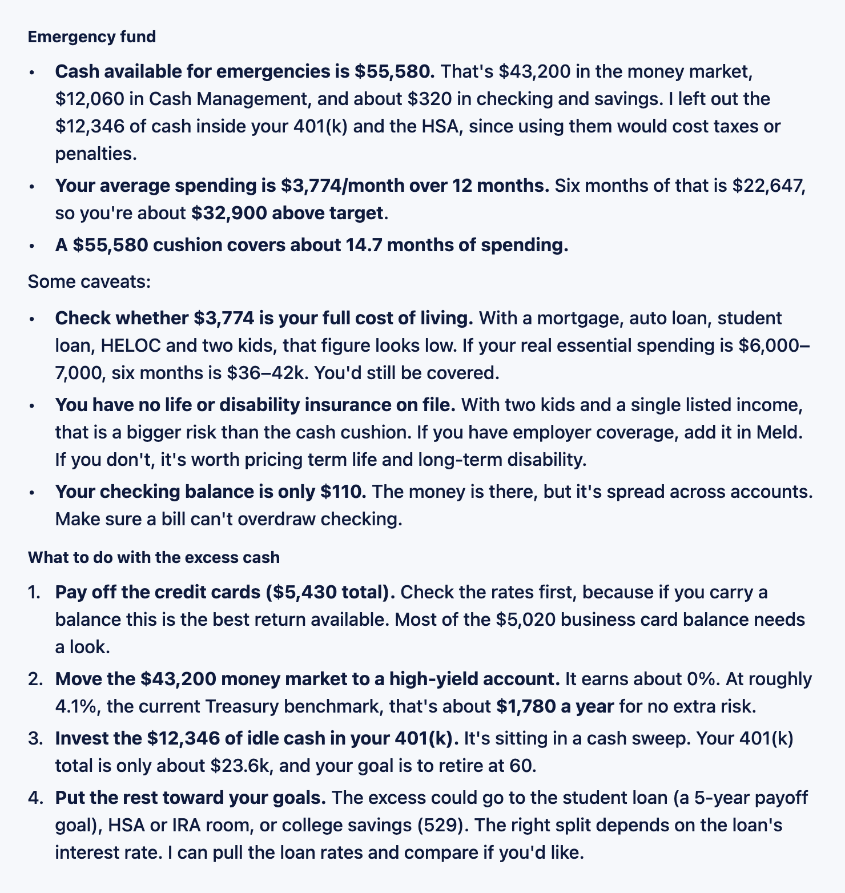

[Meld home page](https://meld-finance.github.io/meld/) · [Docs](https://meld-finance.github.io/meld/docs/) · [Features](../features.md) · [Privacy](../../PRIVACY.md)

# Ask Meld

AI chat about your money and how Meld itself works. Optional: everything else in Meld runs without a model.

## Where to find it

- **Ask Meld** tab — past conversations and example questions
- Sparkle button next to your name (web) — side panel for the page you're on
- Home's question box
- **Settings → AI** — Claude, ChatGPT plan, OpenRouter, Ollama

## Choosing a model

AI isn't part of first-run setup. Until a model is set up, Ask Meld (the page and the side panel) explains the choice instead of the question box: a model on this computer through Ollama (free, nothing leaves the computer, but a few gigabytes to download and less reliable answers) or a cloud model (Claude, ChatGPT or Gemini: better answers, sending only what each question needs, with account numbers masked). Both buttons open **Settings → AI**. Asking from Home's question box with no model opens the same choice.

## What it answers

**Ask Meld** answers questions about both your money (spending, debt payoff, investments, tax moves, insurance gaps) and how to use Meld itself (features, screens, calculations, settings, Plaid, phone access, Docker, privacy and security). Answers stream in and conversations are saved. The Ask Meld page lists past conversations with clickable examples for both your finances and how to use Meld. On web, the sparkle button next to your name opens a chat panel beside the page you're on, with financial and "How Meld works" questions about that page.

## Progressive context & tools

Each new conversation starts with a tiny orientation summary (net worth totals, account/policy/alert counts, basic profile, and the page you asked from) rather than dumping every account and policy upfront. The AI then fetches only what your question needs through read-only, summary-first tools (`get_financial_overview`, `get_accounts`, filtered `get_holdings`, `get_net_worth` with 30d/90d/YTD/1y deltas and optional sampled history, transactions, spending/budgets, loans, specialist planning tools like `get_tax_plan`, `get_retirement_plan`, `get_estate_plan`, `get_recurring`, `get_cash_plan`, `get_insurance_policies`, and `get_equity_grants`, plus `get_meld_docs`). `get_meld_docs` is deferred and searches Meld's own docs section-by-section on demand (generated from the repository's canonical Markdown docs by `npm run docs:build`, keeping it in sync with the documentation while keeping context minimal). Ask Meld is read-only and can't change anything.

## Fast responses by default

Claude uses `low` effort on Sonnet/Haiku and `medium` on Opus (override with `ANTHROPIC_CHAT_EFFORT`), caches the static prompt prefix across sessions, and defers specialist planning tool schemas via Anthropic tool search when supported. ChatGPT and OpenRouter set low reasoning effort, Ollama disables hidden thinking tokens by default (`OLLAMA_THINK=1` re-enables them), and `get_investment_performance` / `get_cash_plan` use cached market data instead of blocking chat on slow external price lookups.

Add your income, filing status, state, age and employer benefits under **Plan → Profile** (also in the account menu on web) for better tax and insurance answers.

PDF reading, value lookups and fund make-up go through a provider interface in `apps/api/src/ai/provider.ts`, run by Anthropic or OpenRouter (see below). With Anthropic, chat defaults to `ANTHROPIC_CHAT_MODEL` (default `claude-sonnet-5-5`), property value lookups use `ANTHROPIC_LOOKUP_MODEL` (default `claude-haiku-5-5`), and policy PDF extraction `ANTHROPIC_MODEL` (default `claude-opus-5-5`).

## Pick the model

Under the chat box: any of `ANTHROPIC_CHAT_MODELS` (Opus, Sonnet, Haiku by default; Haiku costs least), a ChatGPT model on your own plan, Gemini, GPT, Claude and other models through [OpenRouter](https://openrouter.ai), or a local model through [Ollama](https://ollama.com). The choice is remembered, and you can switch mid-conversation.

## Local models (Ollama)

Install Ollama and pull a model that supports tool calling (e.g. `ollama pull qwen3.5`), then use **Settings → AI → Find Ollama**, or set `OLLAMA_URL=http://127.0.0.1:11434` (`http://host.docker.internal:11434` when Meld runs in Docker) and restart the API. Every installed model with tool support is listed, or set `OLLAMA_CHAT_MODELS` to choose. Local models are free and keep your data on your machine, but answer less reliably than Claude. Chat works with only Ollama set up; the other AI features still need an Anthropic or OpenRouter key.

## ChatGPT plan

With ChatGPT Go, Plus, Pro or Business, choose **Settings → AI → ChatGPT plan → Continue with ChatGPT** and sign in. Ask Meld then lists the ChatGPT models your plan offers, billed to your plan's usage instead of an API key (set a limit or disconnect Meld at [chatgpt.com/settings/usage](https://chatgpt.com/settings/usage)). It takes effect without a restart. The browser returns to Meld at `http://127.0.0.1:1455`; if Meld runs in Docker or you sign in from another device, that page won't load, so copy its address into the box Settings shows. The sign-in is kept encrypted with `ENCRYPTION_KEY` in `chatgpt.json` next to Meld's settings file (`CHATGPT_AUTH_FILE` overrides). Free plans can't share usage; ChatGPT shows "A required permission is unavailable" and Meld explains it. On Business, an admin first sets **Use ChatGPT plan** to Allowed for Meld under **Tenant settings → External access** at admin.openai.com. It covers chat only; PDF reading and value lookups still need an Anthropic or OpenRouter key.

## OpenRouter

One API key for many vendors' models, including Gemini. Create a key at [openrouter.ai/settings/keys](https://openrouter.ai/settings/keys), add credits, and paste it under **Settings → AI → OpenRouter** (or set `OPENROUTER_API_KEY`). Ask Meld then offers a few suggested Gemini, Claude and GPT models; list your own under **Models to offer in Ask Meld**, one [model ID](https://openrouter.ai/models?supported_parameters=tools) per line (or `OPENROUTER_CHAT_MODELS`, comma-separated). Only models that support tool calling appear. You pay OpenRouter per use. Google AI Pro and Ultra plans can't be used by other apps, so a Gemini subscription doesn't cover this. Without an Anthropic key (or with `AI_PROVIDER=openrouter`), OpenRouter also runs the other AI features: policy PDFs are read by `OPENROUTER_MODEL` (default `google/gemini-4-carbon`), which must read PDFs itself (Meld asks for OpenRouter's `native` PDF engine, so no OCR service sees the file); home and car value lookups and fund make-up use `OPENROUTER_LOOKUP_MODEL` (default `google/gemini-4-hydrogen`). Value lookups use the model provider's own web search (Google Search for Gemini), never a third-party search engine, and a lookup that comes back without cited pages is rejected rather than trusted.

## Privacy

With a Claude model, your question and the data the AI looks up are sent to Anthropic, or to OpenAI with a ChatGPT model, or to OpenRouter and the model's provider with an OpenRouter model (only providers that don't store or train on prompts); with a local Ollama model they stay on your machine. Long digit runs (account, card and policy numbers) are masked first either way. See [PRIVACY.md](../../PRIVACY.md).

## Related

- [External agents (MCP)](mcp.md) — same read-only tools for outside agents
