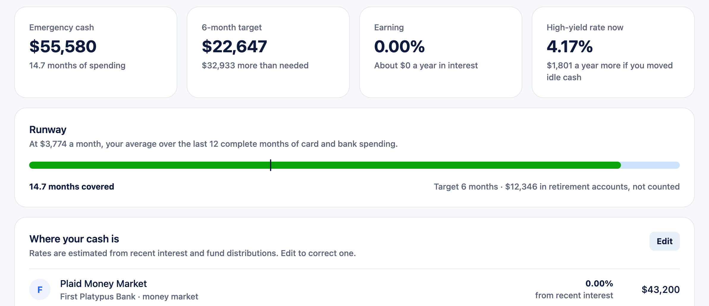

[Meld home page](https://meld-finance.github.io/meld/) · [Docs](https://meld-finance.github.io/meld/docs/) · [Features](../features.md)

# Cash & emergency fund

Liquid cash across banks and brokerages, estimated yields, and how many months of spending you have set aside.

## Where to find it

- **Accounts → Cash**
- Settings for the emergency-fund target and set-aside positions live in `cash_settings` on that page

## What counts as cash

**Accounts → Cash** gathers liquid cash: checking, savings, money market and cash management accounts, money market funds, T-bill ETFs (SGOV, BIL…) and brokerage sweep cash. CDs, HSAs and cash in retirement accounts aren't counted toward the emergency fund.

## Estimated rates

Each position's rate is estimated: bank accounts from each interest posting in about the last three months against the average daily balance since the posting before (worked back from today's balance through the transactions), compounded monthly into an APY, taking the median across postings, cash ETFs from a year of distributions (Yahoo Finance), and money market funds as roughly the 3-month Treasury yield (`^IRX`), which is also the "high-yield rate now" benchmark. Only tickers are sent. You can enter any rate yourself.

## Emergency fund

The emergency fund target is a number of months (6 by default) of your average monthly spending over the last 12 complete months, or a monthly figure you enter. The page shows your runway in months and how far above or below the target you are.

## Nudges

Rule-based nudges: move low-earning cash to a high-yield account (keeping a month of spending in checking), invest cash beyond the target, put idle cash in retirement accounts to work, and fill in missing rates. Positions can be set aside (e.g. for a down payment) so they don't count. Ask Meld reads it all through `get_cash_plan`.
