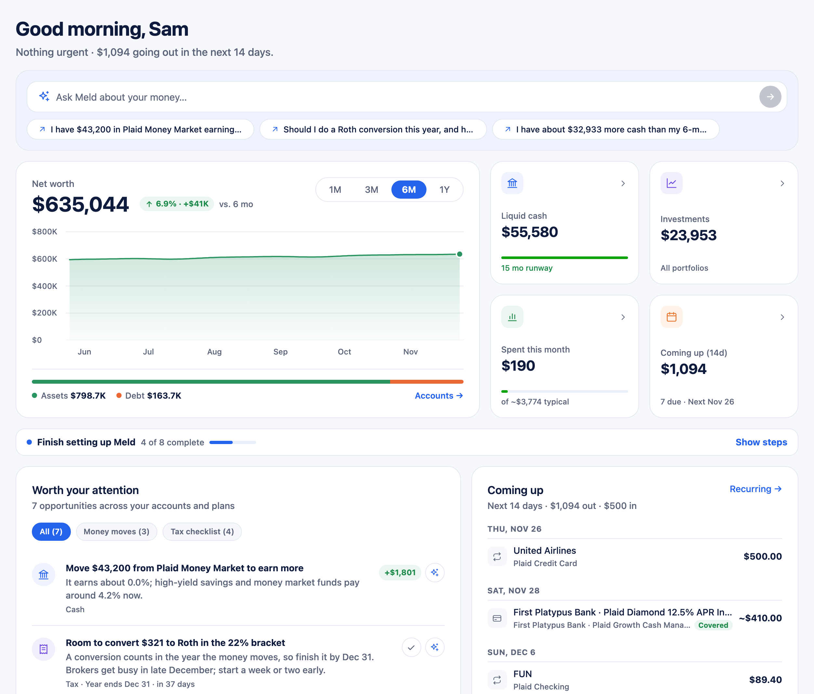

[Meld home page](https://meld-finance.github.io/meld/) · [Docs](https://meld-finance.github.io/meld/docs/) · [Features](../features.md) · [Plaid setup](../plaid.md)

# Demo data & tour

Look around without Plaid keys or a passphrase. The demo household is built so every area of Meld has something real to show.

## Where to find it

- Welcome screen → **Look around first** (**Start with tour** or **Explore on my own**), or set `MELD_DEMO=1`
- Anytime after linking real accounts (including `.env` installs): **Account menu → Demo mode…** or **Settings → Demo mode**
- While demo data is showing: **Start tour** / **Show tour**, **Reset data**, and **Back to my accounts** (or **Connect my banks**) in the purple **DEMO MODE** bar pinned to the top of every screen

## The Rivera household

**Look around first** (or switching into demo mode anytime) shows a made-up household, the Riveras, in its own database (`meld_demo`, or `DEMO_DATABASE_URL`), with two years of history dated up to today. Your real database stays untouched and hidden while demo data is active.

The household is built so every area has something to show: checking that won't cover the card's autopay after childcare and the phone bill (an urgent alert), a Netflix price rise and a new Headspace charge, Disney+ stopped, eating out pushing food over budget, savings earning 0.4%, 401(k), HSA and Roth IRA room, a fund to harvest for a tax loss, a rollover IRA with no beneficiary, and a will older than the younger child.

It's rebuilt automatically once it's two days old, so due dates and alerts stay current; changes you make to it don't last, and you can rebuild it anytime with **Reset data** in the demo bar (or **Reset demo data** in **Settings → Demo mode**). Demo connections never call Plaid: **Refresh** just says they're up to date, and **Link account** is replaced by **Connect my banks** (or **Back to my accounts** once Plaid keys are saved).

## Switching in and out

Even after linking real accounts (or in `.env`-configured installs), opening **Account menu → Demo mode…** or **Settings → Demo mode** switches into the isolated `meld_demo` database at runtime without restarting Meld.

When entering demo mode, choose between **Start with guided tour** or **Explore sandbox on my own**, with an optional **Start with fresh sample data** toggle to rebuild the Riveras before switching.

While demo mode is active, a purple **DEMO MODE** bar remains pinned at the top of every screen so you always know you are looking at sample data. Click **Back to my accounts** in the bar (or **Use my accounts** in Settings) to return immediately to your own database without restarting.

## The tour

The tour starts when you choose **Start with tour** from the welcome screen, **Start with guided tour** from the Demo mode modal, or **Start tour** in the demo bar. It walks through ten questions people ask about their money:

1. What am I worth?
2. Will a payment bounce?
3. Where does my money go?
4. What am I subscribed to?
5. Is my cash earning enough?
6. Am I on track to retire?
7. Am I missing tax savings?
8. Would my family know what to do?
9. Can I just ask?
10. Ready for your own numbers?

Each stop opens the page that answers that question. The tour floats over the page, can be minimized to a pill, and picks up where it left off after a reload.

## Connect your own banks

**Connect my banks** (in the demo bar, **Settings → Demo mode**, and **Settings → Bank connections**) opens the guided Plaid sign-up. Saving your keys switches Meld to your own, empty database. See [Linking accounts](accounts.md) and [Connecting your accounts with Plaid](../plaid.md).
