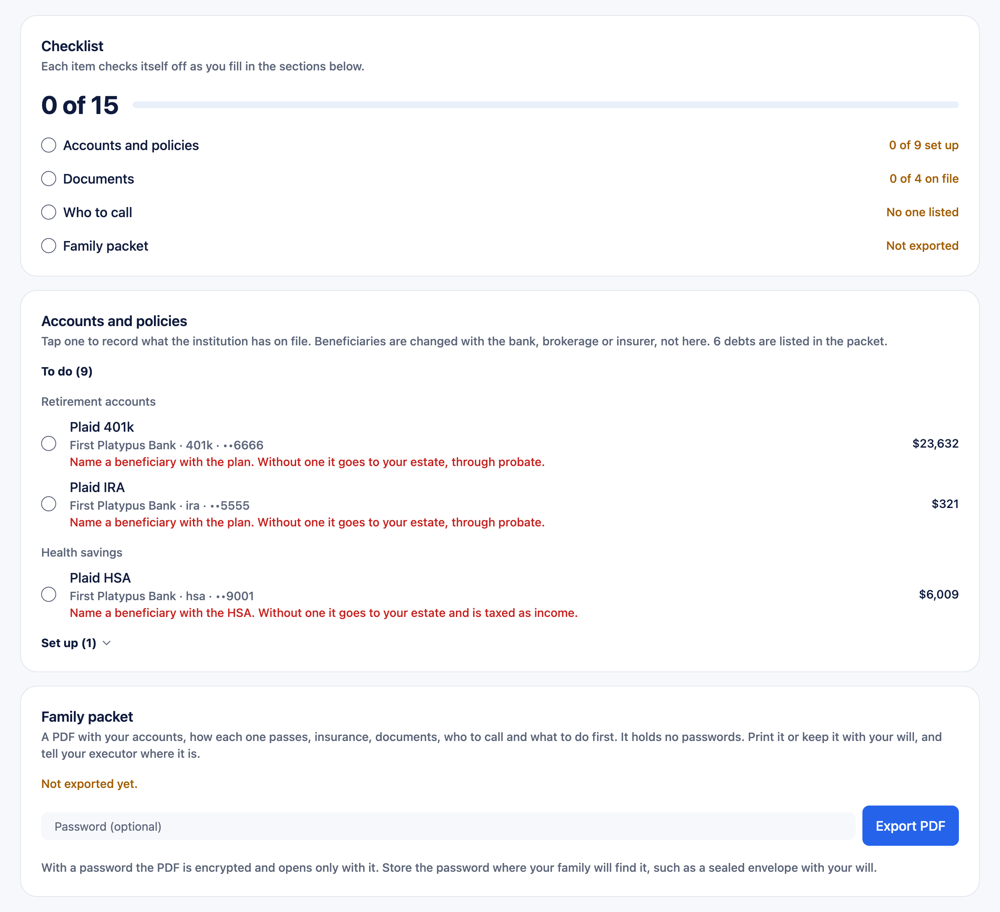

[Meld home page](https://meld-finance.github.io/meld/) · [Docs](https://meld-finance.github.io/meld/docs/) · [Features](../features.md)

# Estate

Check that everything you own passes the way you intend, keep estate documents in one place, and build a packet your family can use. It helps you organize; it isn't legal advice.

## Where to find it

- **Plan → Estate** — checklist, accounts, documents, contacts, family packet
- **On death** on an account's page (or tap a row on Estate)
- Estate planning alerts under Alerts

## Checklist

Four steps that check themselves off: every account and policy set up, the core documents on file, someone to call, and a current family packet.

## Accounts and policies

A **To do** list first, each row saying what's missing in a sentence. Rows that are already set up fold away under **Set up**. When several accounts would go through probate with nothing set up, **Leave them to my will** marks them all "By will" in one go. Each account, home or other asset (tap it, or **On death** on an account's page) records how it passes:

- a beneficiary designation
- transfer or payable on death (or a TOD deed for property)
- joint with survivorship
- one of your trusts
- by will

Beneficiaries are primary or contingent, with shares, as the institution has them on file. Life policies use the beneficiaries on the policy. Kept in `estate_designations`, apart from synced data.

## Full account numbers

**Full account numbers** for the packet are optional, typed in on the account's estate screen and stored encrypted with `ENCRYPTION_KEY`. The app only ever shows the last 4. For a linked checking or savings account, **Get from bank** fetches the number through Plaid Auth. Auth must be enabled for your Plaid account, and Plaid bills it once per connection. The first time, Meld asks you to reconnect the bank and allow account numbers. Set `PLAID_ADDITIONAL_CONSENTED_PRODUCTS=auth` to ask for that when you link new banks.

## Readiness checks

Pure rules in `apps/api/src/lib/estate.ts`, shown on the row they're about:

- a retirement account, HSA or life policy with no beneficiary (a new account is called out)
- accounts and property that would go through probate, or sit outside your revocable trust once you have one
- shares that don't add to 100%, your estate named as beneficiary, or a minor child from your profile named directly
- no contingent beneficiary
- designations and documents not reviewed in the interval you pick (3 years by default)
- a missing will, financial power of attorney or healthcare directive, and no guardian named when you have minor children
- a child born after a will or trust was signed
- a document drafted in another state than your profile's

## Documents and trusts

`estate_documents`: missing core documents are listed as rows to add. Each document records its type, date signed, state, when you last reviewed it, where the signed original is kept, the people it names (trustees, successor trustees, executor, agents, guardians) with contact details, the attorney, and an optional scanned PDF, encrypted like policy PDFs.

## Contacts and instructions

`estate_settings`: executor, attorney, CPA, advisor, employer HR and others; a note on where to find logins (Meld never stores passwords); and a letter to your family.

## Family packet

**Export PDF** builds a PDF from today's data on your machine, optionally encrypted (AES-256) with a password. It holds instructions, who to call, first steps, every document and who it names, each account and policy with how it passes and its beneficiaries, property, debts, and bills on autopay or to cancel. Print it or keep it with your will. Meld remembers what it contained (a hash, not a copy) and flags it as out of date when beneficiaries, documents, contacts or accounts change, or after a year. Balance changes alone don't count. Export works in the web app for now.

## Alerts

An account or policy with no beneficiary, and an out-of-date packet, show under Alerts (informational, so not pushed by default). Turn them off with **Estate planning** on the Alerts page.

Ask Meld reads all of this through `get_estate_plan`, with names and roles but no contact details.
