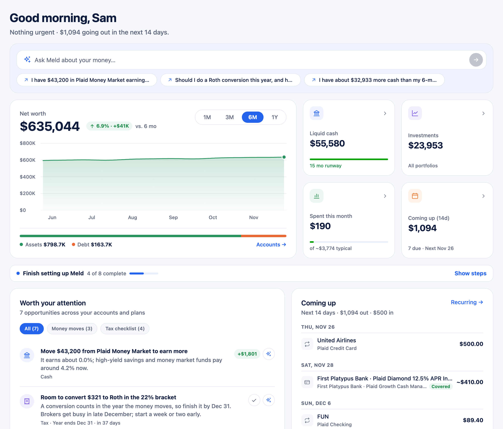
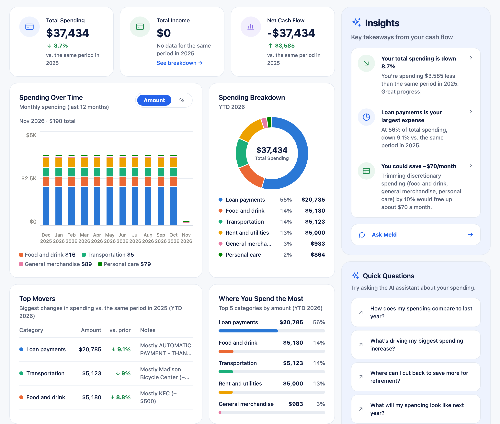

[Meld home page](https://meld-finance.github.io/meld/) · [Docs](https://meld-finance.github.io/meld/docs/) · [Features](../features.md)

# Home, spending & budgets

Net worth on Home, cash flow and category breakdowns on Spending, and monthly budget targets.

## Where to find it

- **Home** — net worth trend, Worth your attention, Coming up
- **Spending → Overview** — cash flow and category charts
- **Spending → Transactions** — list, recategorize, rules
- **Spending → Budgets** — monthly targets per category

## Net worth

**Net worth** = linked balances + manual assets (home, vehicles; add them on the Accounts tab) + life insurance cash surrender value − credit, loan and mortgage balances. Meld records one snapshot per day (after each sync and every 6 hours), so the trend line starts after the second day.

## Cash flow

**Cash flow** counts cash and credit card accounts only. Transfers between your accounts and credit card payments are excluded, so card purchases aren't double counted. Income is anything categorized `INCOME`; spending is everything else, net of refunds. Recategorize a transaction to change where it counts.

## Category drill-down

**Drill into a category** by tapping it on **Spending → Overview** (Spending Breakdown, Top Movers, Where You Spend the Most): spending by subcategory and merchant against a year earlier, and the transactions behind it. Subcategories are Plaid's detailed categories (e.g. Groceries vs. Restaurants under Food and drink) unless you set your own.

## Recategorize and rules

**Recategorize** by tapping any transaction: pick a category and subcategory, or type new ones. Turn on **Always categorize matching transactions this way** to create a rule: new transactions whose merchant or description contains the text you give are categorized as they sync, and optionally past matches you haven't changed by hand are updated too. The longest matching pattern wins, and a hand edit always overrides a rule. Manage rules from **Spending → Transactions → Rules**; deleting one puts its transactions back to their original category.

## Budgets

**Budgets** are monthly targets per category, set under **Spending → Budgets**.

## Related

- [Recurring, autopay & alerts](recurring-and-alerts.md)
- [Cash & emergency fund](cash.md) — spending feeds the emergency-fund target
