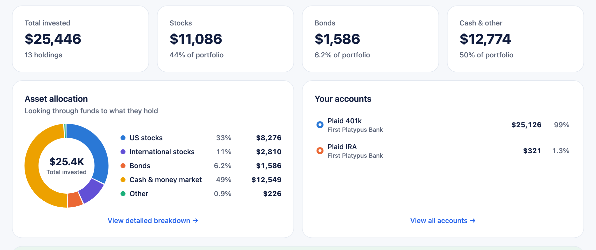

[Meld home page](https://meld-finance.github.io/meld/) · [Docs](https://meld-finance.github.io/meld/docs/) · [Features](../features.md)

# Investments & loans

Holdings with cost basis, performance and exposure views, investment income, and loan/card payoff estimates.

## Where to find it

- **Accounts → Investments** — Overview, Performance, Exposure, Income, Holdings
- Tap any account for details; loans and cards show payoff estimates
- **Hide from totals** on an account's page

## What syncs

Holdings (with cost basis and gain/loss), investment transactions (2 years), and loan/card details (rate, payment, due date, escrow) sync with every refresh when the institution supports Plaid's Investments and Liabilities products.

## Investment views

**Accounts → Investments** has six views:

- **Overview**: totals, asset allocation and accounts.
- **Performance**: gains over 1M/3M/YTD/1Y/all and each calendar year, kept separate from deposits and withdrawals, with time-weighted growth rates (annualized past a year), in total and by account. History before Meld's first daily snapshot is estimated by replaying investment transactions backward from today's holdings against daily closes from Yahoo Finance (only tickers are sent; cached in `price_history`). Holdings without a public ticker (e.g. 401(k) pooled funds) are priced from their own transactions instead, and accounts with little transaction history are flagged.
- **Exposure**: sector, region and bond-type breakdowns plus your largest positions, with an **Include unvested RSUs** toggle on Concentration to see combined single-stock risk.
- **Income**: dividends, interest and reinvestment from investment transactions, with yield.
- **Holdings**: every position, filterable by account or search.
- **Equity**: track RSU grants and vesting schedules (with standard schedule presets, AI PDF/table extraction, and historical vest-date pricing from Yahoo Finance or manual prices for private companies). Unvested RSUs are excluded from net worth and portfolio totals until vested (including Plaid stock-plan holdings reporting unvested shares).

All count only your ownership share of joint accounts.

## Look-through exposure

**Look-through exposure** (what's inside your funds) is an AI estimate from each fund's published allocation, looked up once per security when you open Investments and refreshed every 90 days. It needs an Anthropic or OpenRouter key; only tickers and fund names are sent.

## Loans, cards, and hiding accounts

Tap any account for details. Loans and cards show a payoff estimate at the current payment.

**Hide from totals** on an account's page excludes it from net worth, cash flow, budgets and lists (e.g. a closed or duplicate account). Hidden accounts are listed at the bottom of the Accounts tab.

Full account numbers that Plaid returns for loans are dropped before storage.
