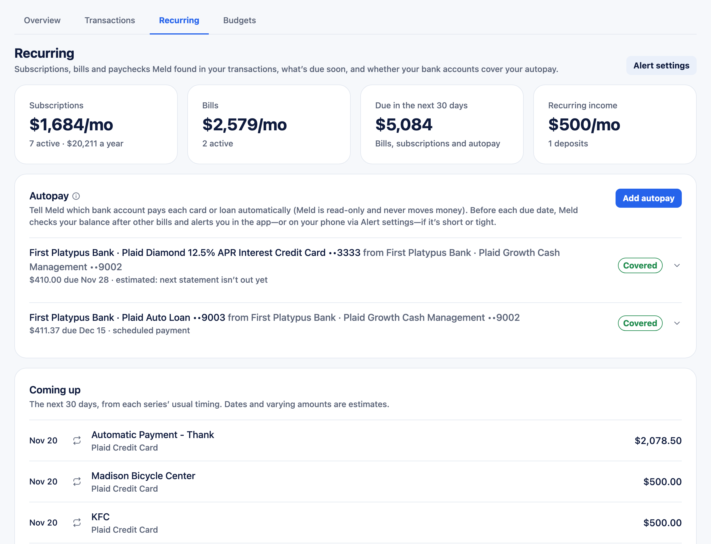

[Meld home page](https://meld-finance.github.io/meld/) · [Docs](https://meld-finance.github.io/meld/docs/) · [Features](../features.md)

# Recurring, autopay & alerts

Subscriptions and bills detected from your history, autopay coverage against the paying account, and alerts you can push to your phone.

## Where to find it

- **Spending → Recurring** — series, Coming up, autopay links
- Bell icon (web) or the Alerts card on Home
- Alert settings and ntfy URL on the Alerts page

## Recurring series

**Spending → Recurring** finds charges and deposits that repeat on a schedule (weekly to yearly) in up to two years of card and bank transactions: subscriptions, bills (utilities, insurance, loans, and anything whose amount varies) and income. A merchant with more than one subscription (an app store) or a membership among other purchases is split by amount. Each series shows its cadence, expected amount, monthly cost, next date, and a badge when a steady price changes. Series that stopped charging are listed separately, since they may have been canceled. Tap one to change its kind, rename it, see its charges, or mark it **Not recurring**. Corrections are kept in `recurring_overrides`; the series are worked out from transactions each time. Transfers and card payments aren't counted, as in cash flow.

## Autopay

**Autopay** links a card or loan to the bank account that pays it, paying the statement balance, minimum, current balance or a fixed amount (a loan pays its scheduled payment). For a card on the statement balance, Meld takes Plaid's last statement less payments since, due on the statement's due date. Once that's paid, or before the next statement is out, it estimates from the current balance. It then checks the bank account's available balance against everything else due from it first: other autopays, recurring bills charged to it, and (optionally) paychecks expected into it at least a day before. Each autopay shows **Covered**, **Tight** (less than your cushion left), **Short**, **Paid** or **Unknown**, with the breakdown. Meld also suggests links when a bank payment and a card payment of the same amount line up a few days apart.

## Coming up

**Coming up** lists the next 30 days of recurring charges, paychecks and autopay payments.

## Alerts

**Alerts** (the bell on web, and a card on Home) are checked after every sync, every 6 hours, and when you change autopay or alert settings:

- an autopay its bank account won't cover (urgent), or that leaves less than your cushion. Estimated amounts only alert within a week of the due date.
- a bank account below a minimum you set
- any charge at or above an amount you set
- a subscription or bill whose steady price went up
- a new recurring charge (shown in the app only, by default)
- a bank connection that needs you to sign in again

Alerts about a state clear themselves once it's fixed; a dismissed one comes back only if it gets worse. Settings are on the Alerts page (`alert_settings`).

## Push to your phone

**Push to your phone** with [ntfy](https://ntfy.sh): install the app, subscribe to a long random topic, and paste its URL under Alerts. Pick whether to push urgent alerts only, warnings and urgent (the default), or everything. Alert text includes account names and amounts, so use your own ntfy server to keep it off the public one (see [PRIVACY.md](../../PRIVACY.md)).

Ask Meld reads all of this through `get_recurring`.
