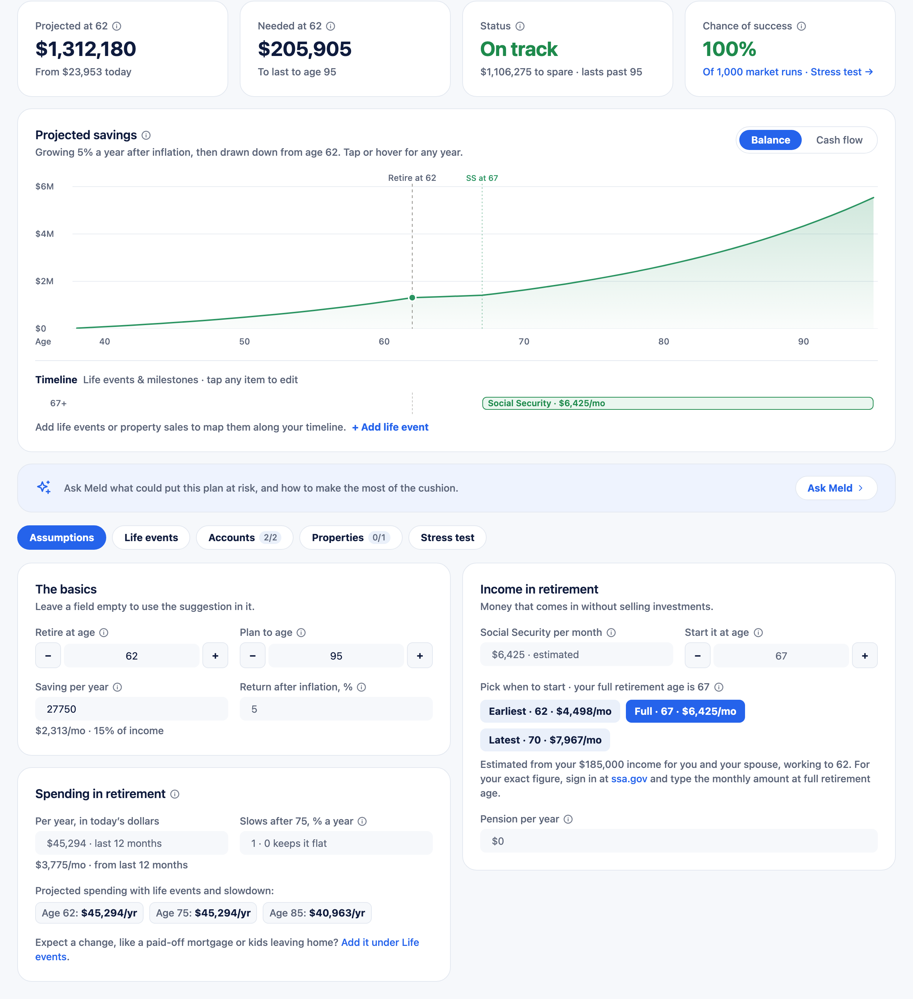

[Meld home page](https://meld-finance.github.io/meld/) · [Docs](https://meld-finance.github.io/meld/docs/) · [Features](../features.md)

# Retirement

Project savings to retirement age, compare with what you'll need, and see the monthly saving that closes the gap—all in today's dollars.

## Where to find it

- **Plan → Retirement**
- Profile birth year, optional partner (name, birth year, income), and income under **Plan → Profile** feed age, bridge-year pay, and Social Security estimates
- Opt a home into the plan from the Accounts tab

## The projection

**Plan → Retirement** projects your savings to retirement age, compares that with what you'll need for your money to last to the age you plan for, and shows the gap and the extra monthly saving that closes it. The chart shows your balance by age, growing until you retire and drawn down after.

Everything is in **today's dollars**: the return is after inflation (5% by default), and spending, contributions, Social Security and pensions are today's amounts.

## Partners and staggered retirement

Add an optional **Partner** (name, birth year and annual gross income) under **Plan → Profile** to give them their own retirement age, plan-to age, yearly savings, Social Security and pension:

- **Joint planning horizon:** Meld projects until whichever partner's plan-to age reaches furthest into the future.
- **Bridge years:** When you and your partner retire at different ages, the years in between are **bridge years**. Meld estimates the still-working partner's after-tax pay (with any active Social Security, pension or net rent) to cover household spending first, draws only any shortfall from savings, and caps bridge saving at the working partner's planned contribution when income covers spending.
- **Life events:** Time spending, saving, income or one-time life events by your age, your partner's age, or a child's age from your profile.

## Ways to adjust your plan

Below the chart, Meld shows single-change options toward a goal—either **Base** (steady expected return) or a Monte Carlo confidence target (**80%**, **85%**, **90%**, or **95%**) lasting to any **Last to age** you choose:

- **When you're short of the target:** see how much more to save per month, how many extra years to work, how much less to spend per month in retirement, or (when delaying to 70 is enough on its own) claiming Social Security later.
- **When you have room to spare:** see how much **more** you can afford to spend per month, how many years **earlier** you can retire, how much **less** you need to save now (down to $0/yr if current savings already cover the goal), and how old your savings still last (**Lasts longer**).

Click **Try it** on any option to preview it in the chart, KPI tiles, and stress test without saving yet, or **Undo** to revert that preview.

## Social Security

**Social Security** is estimated from your profile's income until you type the monthly amount at full retirement age from your statement (ssa.gov/myaccount). The estimate uses today's benefit formula and wage base, assuming you earn your current pay from 22 until you retire (up to 35 years).

- **With a partner on your profile:** Each person's benefit is estimated from their own income and stop-work age (or overridden individually) and claimed at their own claiming age (67 by default). When married and no statement figure is entered for the lower earner, Meld adds a spousal top-up up to half of the higher earner's full benefit (capped at full retirement age, with no delayed credits past FRA on the spousal top-up).
- **Without a partner on your profile:** A married estimate takes the lower of one earner plus a spousal benefit and two equal earners.

Meld adjusts the benefit for the age you claim: less before full retirement age, 8% a year more on your own benefit after it up to 70. Buttons show what 62, full retirement age and 70 pay, and tapping one sets the claiming age.

## Which accounts count

Every visible investment account counts at your ownership share, except 529, Coverdell, UTMA/UGMA and other education or custodial accounts. Turn off any account you're saving for something else (a down payment, say), and add cash set aside for retirement as **Other savings**.

Empty fields use suggestions: age from your profile's birth year, retirement at 65, planning to 95, and spending from your last 12 full months of cash flow. Edits update the projection as you type; **Save assumptions** keeps them.

## Properties

**Properties** you'd sell to fund retirement can count too. Turn on a home from the Accounts tab and set the age you'd sell it, its mortgage, and net rent per year (rent minus costs). At that age your share of the price (grown 1% a year after inflation by default, less 6% selling costs) minus what's left on the mortgage joins your savings; rent counts as saving before retirement and as income after, until the sale. The mortgage balance is projected from its rate and payment; taxes on the gain aren't included.

Ask Meld can read the plan and try what-ifs ("what if I retire at 60?") without changing what you saved.
