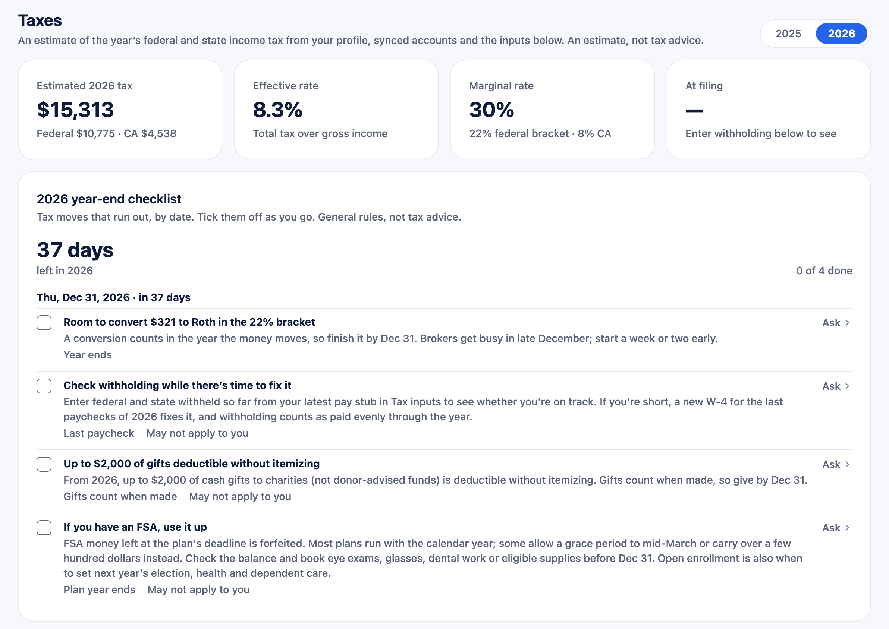

[Meld home page](https://meld-finance.github.io/meld/) · [Docs](https://meld-finance.github.io/meld/docs/) · [Features](../features.md)

# Tax

Estimate this year's (or last year's) federal and state income tax, see where you land in the brackets, and get rule-based suggestions for harvests and contribution room.

## Where to find it

- **Plan → Tax**
- Household income and filing status under **Plan → Profile**
- Per-year overrides in tax settings on the Tax page

## The estimate

**Plan → Tax** estimates this year's (or last year's) federal and state income tax: effective and marginal rates, where your income lands in the brackets, and what you're on track to owe or get back. It's an estimate, not a return.

## Income and gains

**Income** starts from your profile's household gross income (yours plus your partner's when filing jointly, or your own when filing separately) and filing status. Tracked RSU vests for the year (vested YTD plus remaining scheduled tranches) are added as their own `RSU vesting` line item, with a toggle in Tax inputs if your Profile figure already includes RSUs. Pre-tax 401(k) deferrals and HSA contributions are projected from what your 401(k) and HSA accounts report. Dividends, interest and fund distributions come from taxable accounts and bank interest. The year is projected as this year so far plus whatever came in over the rest of last year, so December distributions count. A dividend's qualified share comes from what the fund holds: its stocks, apart from REITs.

**Realized gains** are rebuilt from buys and sells with average cost, because Plaid reports one cost basis per holding and no lots. Holding periods follow shares in the order they were bought. Enter your broker's figures to replace the estimate.

## Tax inputs

**Tax inputs** (per year, in `tax_settings`) cover what Meld can't see:

- self-employment profit
- other income
- withholding and estimated payments
- property tax and other itemized deductions
- HSA coverage
- whether you have a workplace plan
- a flat state rate for states without tables

## Tables

- Federal brackets, deductions, capital gains rates, NIIT, additional Medicare and self-employment tax, the SALT cap and the child tax credit for 2025 and 2026, plus contribution limits and Roth/IRA phase-outs. The 2025 figures include the One Big Beautiful Bill changes.
- California uses FTB's 2025 schedules (2026's aren't out yet), adding back HSA money and taxing gains as ordinary income.
- States without an income tax owe nothing.
- Tables live in `packages/shared/src/tax-tables.ts`; add a year there when the IRS and FTB publish it.

## Suggestions

**Suggestions** are fixed rules, each with the estimated tax saved this year. They cover:

- tax-loss harvesting, with wash-sale warnings for purchases or RSU vests within 30 days in any account
- RSU supplemental withholding gaps and $0 cost-basis checks on vested RSU holdings
- gain harvesting at 0%
- 401(k), HSA and IRA room
- a backdoor Roth, with a pro-rata warning when pre-tax IRAs have money in them
- a SEP IRA or solo 401(k) for self-employment income
- Roth conversion room in low brackets
- an underpayment warning

Tap one to ask Ask Meld about it.
