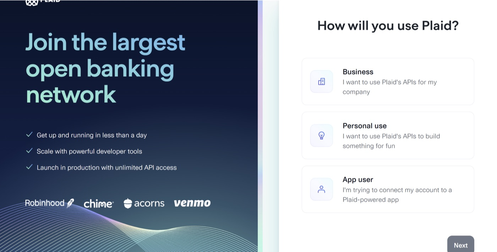
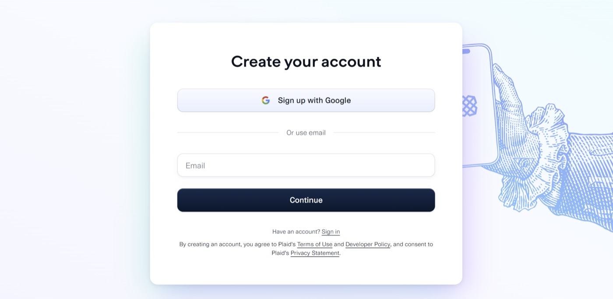
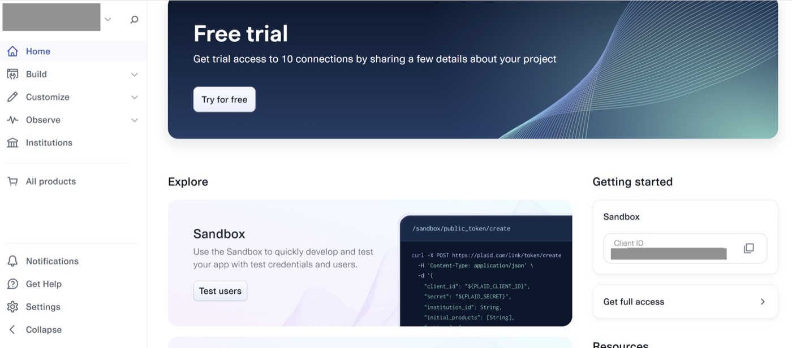
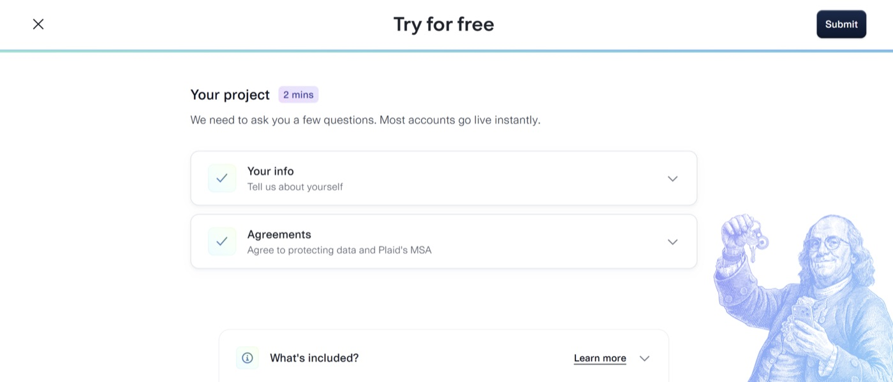
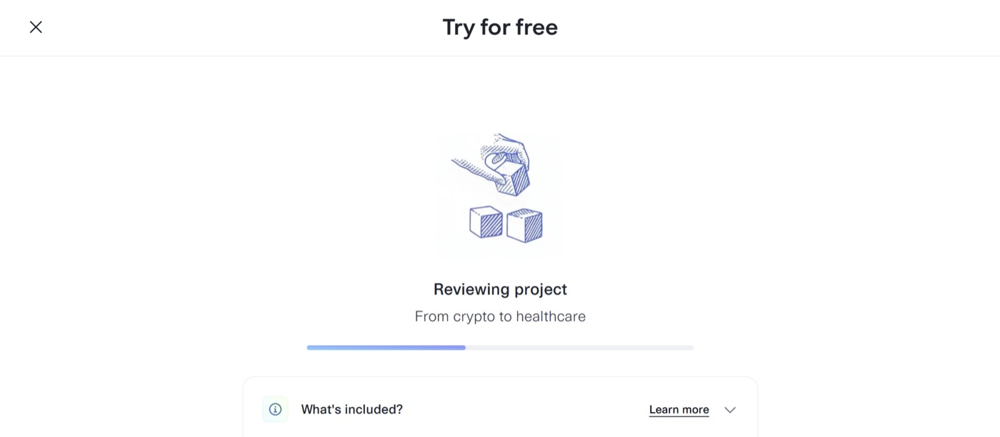
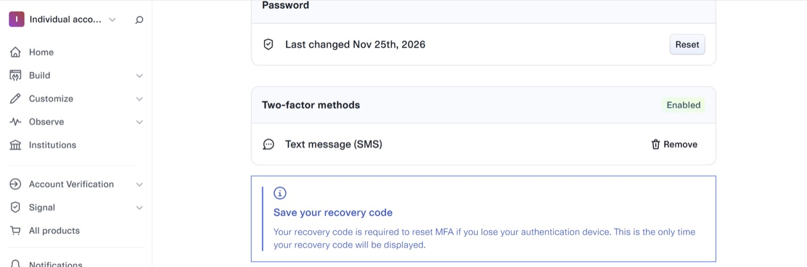
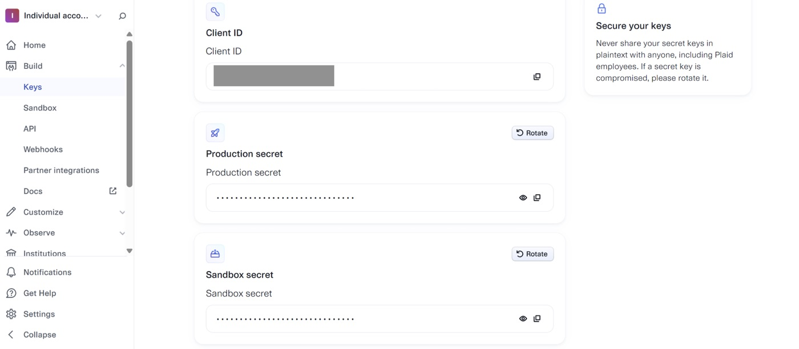

[Meld home page](https://meld-finance.github.io/meld/) · [Docs](https://meld-finance.github.io/meld/docs/) · [README](../README.md) · [Install](install.md) · [Features](features.md) · [Phone access](phone-access.md)

# Connecting your accounts with Plaid

Meld pulls balances, transactions, investments and loans from your banks and brokerages through [Plaid](https://plaid.com), the service apps like Venmo use to connect to banks. You use **your own** free Plaid account, so the connection is between you, Plaid and your bank. Meld's author never sees your keys or your data.

Plaid's sign-up is built for companies writing apps, so it asks a few questions that don't obviously apply to you. This page shows exactly what to click, as of November 2026. Plaid changes its site from time to time, so if something here doesn't match, look for the closest option and check [Plaid's docs](https://plaid.com/docs/).

**Before you start.** It takes about 10 minutes. You'll need an email address, a phone that gets text messages, and your home address and date of birth (Plaid asks for them). It's free for up to 10 bank logins.

Not ready yet? Choose **Look around with demo data** on Meld's welcome screen. Meld shows a made-up household and a short tour, and you can connect your banks whenever you like from the **Connect my banks** button.

## Get your Plaid keys

### 1. Sign up and choose Personal use

Go to https://dashboard.plaid.com/signup. When Plaid asks how you'll use it, choose **Personal use** ("I want to use Plaid's APIs to build something for fun") and click **Next**.

### 2. Create your account

Sign up with Google, or with your email and a password.

### 3. Click "Try for free"

On Plaid's home page, click **Try for free**. It's either in the **Free trial** banner at the top or under the Sandbox client ID on the right.

Don't choose **Get full access**. That's Plaid's business verification, which asks about your company and isn't needed for your own accounts.

### 4. Fill in your info and submit

Under **Your info**, enter your name, address, phone number and date of birth. Under **Agreements**, accept Plaid's terms. Then click **Submit**.

Plaid reviews it. Most accounts are approved within a minute.

### 5. Turn on two-step sign-in

Plaid only shows your production secret once two-step sign-in is on. Open **Settings** at the bottom left, add **Text message (SMS)** under **Two-factor methods**, and save the recovery code Plaid shows you somewhere safe.

### 6. Copy your keys into Meld

Open **Developers → Keys** (https://dashboard.plaid.com/developers/keys). You need two values: the **Client ID** and the **Production secret**. Ignore the Sandbox secret.

**In the desktop app:** on the welcome screen choose **Connect my banks**, or, if you're looking at demo data, click **Connect my banks** in the demo bar or under **Settings → Bank connections**. The same six steps are there, with these pictures. Paste the two keys into the last step, click **Test keys** to check them, then **Finish** (or **Save and link accounts**). Meld restarts on your own, empty accounts, and the demo household goes away.

**With Docker:** in `.env`, set `PLAID_CLIENT_ID`, `PLAID_PRODUCTION_SECRET` and `PLAID_ENV=production`, then restart Meld (`docker compose up -d`).

Then go to **Accounts → Link account**, pick your bank and sign in to it in Plaid's window. Repeat for each bank.

## What the free plan covers

New Plaid teams in the US and Canada get the free **Trial** plan with real data:

- Up to **10 connections** (Plaid calls them "Items"). One connection is one login at one institution, however many accounts sit behind it; a bank login with checking, savings and a card is one.
- **Removing a connection doesn't give the slot back**, so don't link and unlink to experiment. Look around with demo data instead.
- It includes the products Meld uses: Transactions, Investments and Liabilities.
- Banks that sign you in on their own site (OAuth), such as Chase, Bank of America and Wells Fargo, work on the Trial plan. Some brokerages, Schwab for example, can take a few business days to switch on after you get production access.

If Plaid asks about your use case, describe it honestly: you're connecting your own accounts to a personal finance app you run yourself.

Real data goes into its own database (`meld`), separate from demo data (`meld_demo`) and Plaid's Sandbox (`meld_sandbox`), so switching back and forth never mixes them. Open **Account menu → Demo mode…** or **Settings → Demo mode** anytime to switch to the demo household (with the guided tour or as a sandbox) without restarting Meld; click **Back to my accounts** in the top demo bar to return.

**Read Plaid's terms yourself.** When you hold Plaid keys you're Plaid's customer, and their [developer policy](https://plaid.com/developer-policy/) and terms apply to you. Decide for yourself whether your use fits them.

## Plaid's Sandbox (for developers)

Sandbox is Plaid's test environment, with made-up banks. It's for working on Meld itself; demo data is the easier way to look around. To use it, open **Settings → Bank connections → Developer options**, paste the **Sandbox secret**, choose **Sandbox (test banks)** and save. With Docker, set `PLAID_SANDBOX_SECRET` and `PLAID_ENV=sandbox` in `.env`. Then link any bank and sign in with `user_good` / `pass_good`.

## When a bank needs you to sign in again

Banks expire connections from time to time: some every 6 to 12 months, some once a year. When that happens the account shows **Reconnect** in Meld. Press it and sign in again; your history is kept.

## More than 10 connections?

Plaid's paid plans charge a monthly fee per connection. For a household that outgrows the Trial plan, consolidating logins (one login per institution) usually helps. Support for cheaper alternatives such as [SimpleFIN Bridge](https://beta-bridge.simplefin.org/) may come later.
